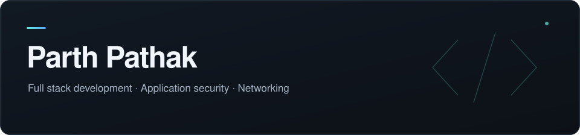

I'm Parth, a CS student who likes building applications and understanding the systems behind them. My interests sit somewhere between writing useful software, securing it, and figuring out how everything talks to everything else.

### On the tech side

- **Web development** — interfaces, APIs, and the backend that ties them together.
- **Security & networking** — how applications behave, communicate, and hold up when things go wrong.
- **Cloud & systems** — containers, deployments, and getting the pieces to work together.

You'll find a mix of projects and experiments here, with a few works in progress along the way.

### Away from the keyboard

Gaming, watching cricket (and questioning the selectors), or adding another anime to an already unreasonable watchlist.

### Contact

- **Email:** [parth.pathak1905@gmail.com](mailto:parth.pathak1905@gmail.com)
- **LinkedIn:** [linkedin.com/in/parth-pathak-584629335](https://www.linkedin.com/in/parth-pathak-584629335/)
- **Website:** [parthpathak719.github.io](http://parthpathak719.github.io/)

---

<i>always working on something. that something usually does not work.</i>

